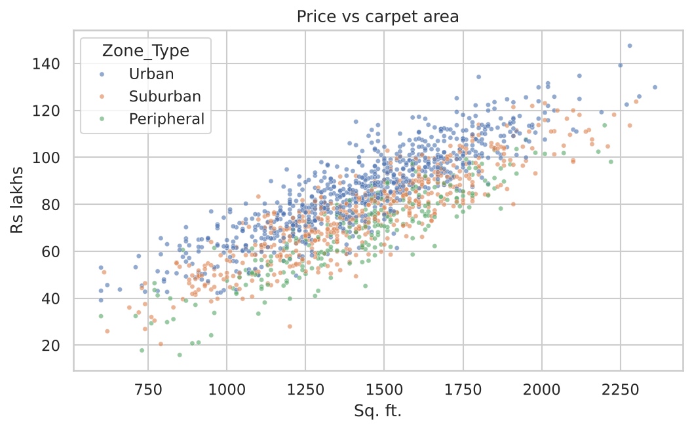
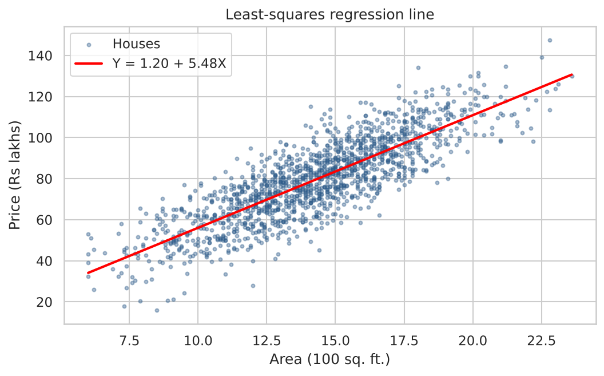
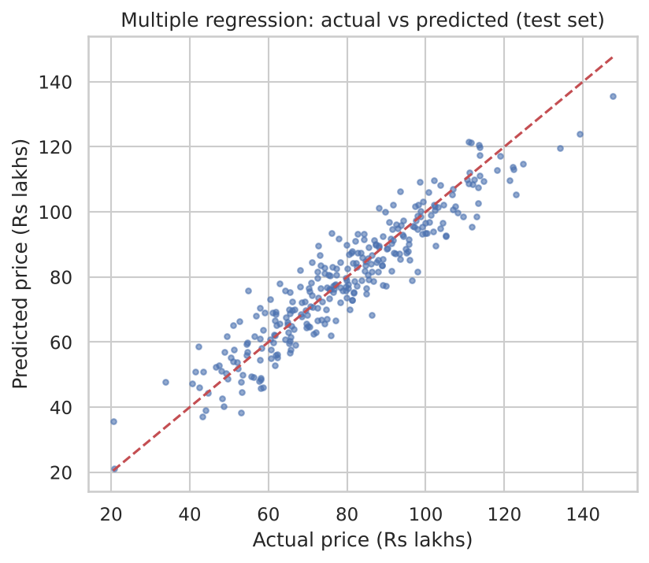

# House Price Prediction using Regression Analysis

**Course:** 26MCAC103 — Business Statistics Using Python · MCA Semester 1 · MIT-ADT University, Pune
**Author:** Divyanshuji Singh (ADT26COMM0753) · **Supervisor:** Dr. Pradnya Muley

A complete statistical analysis of a residential housing dataset (N = 1,500 houses, 10 variables):
descriptive statistics, correlation, hypothesis tests, simple and multiple least-squares regression,
diagnostics, hold-out / cross-validation and price prediction with 95% prediction intervals.
All code is in one Jupyter notebook of 31 cells.

## Project report

The full written report (chapters 1–8, tables, figures and the notebook code as Jupyter cells) is in
[`report/House_Price_Prediction_Report.pdf`](report/House_Price_Prediction_Report.pdf).

The project slides are in [`presentation/`](presentation/House_Price_Prediction_Presentation.pptx).

## Repository structure

```
house-price-prediction/
├── house_price_analysis.ipynb   # the full analysis (31 code cells, outputs included)
├── generate_data.py             # creates housing.csv (seed 42 -> reproducible)
├── housing.csv                  # dataset: 1,500 rows x 10 columns
├── fig/                         # 10 figures saved by the notebook (Fig 3.1 - 6.1)
├── report/
│   └── House_Price_Prediction_Report.pdf   # full project report (39 pages)
├── presentation/
│   └── House_Price_Prediction_Presentation.pptx   # project slides
├── requirements.txt
├── LICENSE
└── README.md
```

## Quick start

```bash
git clone <your-repo-url>
cd house-price-prediction
python -m venv .venv && source .venv/bin/activate      # Windows: .venv\Scripts\activate
pip install -r requirements.txt
python generate_data.py                                 # optional: housing.csv is already included
jupyter notebook house_price_analysis.ipynb             # Kernel > Restart & Run All
```

## Dataset (`housing.csv`)

| Column | Meaning |
|---|---|
| `House_ID` | Unique identifier (excluded from modelling) |
| `Price_Lakhs` | Selling price in ₹ lakhs — **target** |
| `Area_SqFt` | Carpet area (sq. ft.) |
| `Bedrooms` | BHK count (1–5, 5 = penthouse) |
| `Bathrooms` | Bathroom count (1–5) |
| `Property_Age` | Age in years (0–40) |
| `Distance_to_Centre` | Distance to city centre (km) |
| `Locality_Score` | Locality / amenity rating (1–5) |
| `Location_Zone` | Central CBD, IT Corridor, West Enclave, Metro Suburb, East Township, Outer Ring |
| `Zone_Type` | Urban / Suburban / Peripheral |

The data are **synthetic**: generated by `generate_data.py` with `numpy.random.default_rng(42)` to reflect a
realistic market structure. Re-run the notebook on recorded transaction data before any real-world use.

## Methods in the notebook

| Chapter | Cells | Content |
|---|---|---|
| 2 | 1–5 | Imports, loading, quality checks, cleaning, derived variables |
| 3 | 6–12 | Mean / median / mode, dispersion, group summaries, bar / histogram / box / scatter plots |
| 4 | 13–19 | Shapiro-Wilk, confidence interval, Pearson & Spearman, chi-square, Welch t-test, ANOVA |
| 5 | 20–27 | Least squares (by hand, `np.polyfit`, `linregress`), `statsmodels` OLS, VIF, Breusch-Pagan, Jarque-Bera, Durbin-Watson, train-test split, 5-fold CV |
| 6 | 28–30 | Price scenarios and 95% prediction intervals |
| 7 | 31 | Consolidated headline results |

## Key results

| Result | Value |
|---|---|
| Mean / median price | ₹79.49 L / ₹79.70 L |
| Area vs price | Pearson r = 0.835, Spearman ρ = 0.830 |
| Zone type × price category | χ² = 145.19 (df = 4, p < 0.001), Cramér's V = 0.22 |
| Urban vs suburban price | Welch t = 9.70, Cohen's d = 0.55 |
| Six zones | ANOVA F = 47.34, η² = 0.137 |
| Simple model | **Price = 1.20 + 5.48 × Area (100 sq ft)**, R² = 0.697 |
| Multiple model | R² = 0.874 · test RMSE ₹7.30 L · MAE ₹5.86 L · MAPE 8.1% · 5-fold CV R² = 0.873 |
| Baseline (mean price) | RMSE ₹20.60 L · MAPE 24.0% |

Multiple regression: each extra 100 sq ft adds ≈ ₹3.97 L, each bedroom ≈ ₹5.04 L, each locality-score point
≈ ₹10.01 L, and each year of age subtracts ≈ ₹0.69 L.

## Figures





## Limitations

Synthetic, cross-sectional data (no sale dates, so no time-series forecasting); linear model; a single city;
coefficients are associations, not causal effects.

## License

MIT — see [LICENSE](LICENSE).
